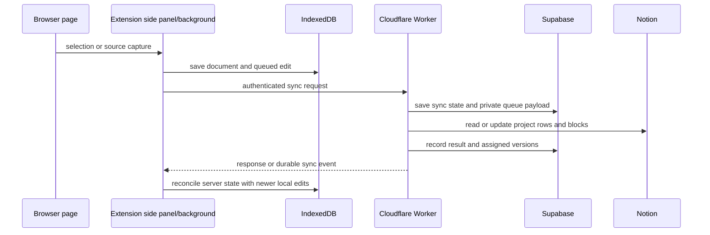

# Codebase map and simplification plan

Snapshot: 2026-10-29, branch `polish`.

## System map

Jottathing is a Chrome Manifest V3 extension, a Cloudflare sync Worker, a Supabase-backed sync store, and a small Vite marketing app. The extension is the user interface and local editing surface; Notion remains the remote project and page store.

| System | Main files | Responsibility |
| --- | --- | --- |
| Extension startup | `wxt.config.ts`, `entrypoints/background.ts`, `entrypoints/content.ts`, `entrypoints/sidepanel/` | WXT builds the background worker, page content script, side panel, and sandboxed code runner. The content script captures page selections and restores highlights. The background script routes extension messages, opens source links, and hands captures to the active editor or local store. |
| Side panel | `entrypoints/sidepanel/App.vue`, `src/stores/jottathing.ts`, `entrypoints/sidepanel/composables/` | Vue and Pinia coordinate workspaces, projects, pages, settings, and sync state. Components render the panels; composables own editor, lifecycle, settings, and selection actions. Tiptap edits document blocks. |
| Capture and source metadata | `src/lib/capturePayload.ts`, `src/extensions/sourceRegistry.ts`, `src/lib/projectStateSources.ts`, `src/services/notionClient.ts` | Validates captured page data, inserts source links and headings, and tracks current per-source entries in project state. Retired map-registry and compressed link-index formats are hidden but no longer imported or rewritten. |
| Local persistence | `src/services/idbStore.ts`, `src/services/notionClient.ts` | IndexedDB stores projects, pages, workspace settings, and local queues in the current `jottathing` database. Writes are serialized through an epoch fence so a connection wipe cannot race another extension context. `notionClient.readStorage` reads and persists normalized IndexedDB state; `normalizeStoredWorkspaceRecords` assigns workspace/account ownership, creates a usable local starter workspace, and migrates page source metadata into project state. Extension storage holds preferences, legal consent, and the pending deletion marker; older app-state copies are no longer imported. Legacy database copying and renamed JSON-key conversion have been removed. |
| Local sync queues | `src/services/syncQueue.ts`, `src/services/notionClient.ts` | Queues metadata-only page operations, separate block edits, and project metadata/source events; compacts superseded edits, assigns local versions, and retries delivery after offline or server failures. |
| Worker API | `apps/worker/src/worker.ts`, `apps/worker/src/routes/` | Hono composes authentication, Notion page lookup, sync mutations and queries, webhooks, and media endpoints. The Worker owns Notion credentials and authorizes requests through Supabase-backed sessions and installations. |
| Notion sync domain | `apps/worker/src/projectDatabase*.ts`, `apps/worker/src/managedBlock*.ts`, `apps/worker/src/blockConversion/`, `apps/worker/src/pageSync.ts`, `apps/worker/src/projectSync.ts` | Uses the managed Notion project database for project and thread sync; converts Tiptap documents to and from Notion blocks; reconciles block identity, ordering, edits, and conflicts. Legacy project and note page-tree sync was removed. |
| Durable delivery | `apps/worker/src/queues/syncQueueConsumer.ts`, `apps/worker/src/services/workerQueueOperations.ts`, `apps/worker/src/syncEvents.ts` | Stores private, versioned sync payloads in Supabase and sends Cloudflare Queue messages with opaque UUID references. Consumers validate the reference and payload, apply Notion mutations, record status, retry transient failures, and publish completion events through a Durable Object. |
| Authentication and deletion | `apps/worker/src/routes/authRoutes.ts`, `apps/worker/src/auth.ts`, `apps/worker/src/notionAuth.ts` | Runs Notion OAuth, accepts only current Jottathing session and account-binding values, serializes OAuth with logout/deletion, and clears local credentials while preserving local documents and queued work. |
| Media | `apps/worker/src/routes/mediaRoutes.ts`, `src/extensions/media*.ts`, `entrypoints/sidepanel/composables/useEditorMedia.ts` | Validates and uploads media through the Worker, refreshes Notion-hosted URLs, and keeps editor media identity stable during sync. |
| Marketing site | `apps/marketing/src/` | Vite app with patch notes and an interactive extension demo. It is independent of extension persistence and sync. |
| Data and tests | `apps/worker/schema.supabase.sql`, `apps/worker/migrations/`, `test/` | The schema and migration history define Supabase persistence and privileged RPCs. Vitest covers capture, storage, sync queues, Notion conversion, auth lifecycle, and Worker behavior. |

### Worker routes

- `authRoutes.ts`: legal pages, OAuth start/callback, session status, logout, connection deletion, and diagnostic logs.
- `notionRoutes.ts`: Notion parent-page search/create and YouTube embed presentation.
- `syncMutationRoutes.ts`: page/block pushes, retries, page resync, project metadata, and project source updates.
- `syncQueryRoutes.ts`: sync status/events, validation, reload, pull, and stale-state cleanup.
- `webhookRoutes.ts`: protected webhook setup, verification-token operations, and Notion change notifications.
- `mediaRoutes.ts`: validated upload and signed-URL refresh.
- `worker.ts`: registers those routes, initializes the runtime, and dispatches normal and dead-letter queue batches.

### Data flow

The event queue carries opaque references; the page/block payload is held in an installation-owned Supabase table. This is why payload cleanup, account ownership, and deletion tests are part of the core sync contract.

Page moves have two paths. Moving within a project only changes page order. Moving across projects creates a new page identity in the destination and archives the source; if it was the source's last active page, a blank replacement keeps the source project usable. The operation also repairs active-page selections and pending sync work, and flushes/reloads first when leaving a Notion-backed source.

Manual resync checks the active account, unblocks and redrives durable queue work, sends unbaselined project snapshots, reconciles dirty or failed pages, then flushes again. It reloads the Notion workspace only after local queues settle with no conflicts or failed uploads; otherwise it leaves remote reload pending.

## Simplification plan

Keep each slice independently reviewable: one behavior change, focused tests, then a commit. Preserve current page content, source provenance, offline edits, conflict review, account isolation, and deletion safety.

1. **Notion project schema compatibility — completed.** The Worker now reads only `Jottathing ID` and `Managed by Jottathing`; it no longer recognizes `Inkwell ID` / `Jot ID`, copies old property values, or scans rows for those names. It still creates missing current properties and handles a current property whose Notion type changes. The connected database has the current schema. `test/projectDatabase.test.ts` (8 tests) and Worker typecheck pass.
2. **Remove obsolete sync-queue adapters — completed.** The consumer now accepts only UUID references to versioned payloads in Supabase. It no longer interprets full inline queue messages, single-operation `op` payloads, or server version `0`. At review time, the connected Cloudflare queues had no backlog and the Supabase payload table was empty. The consumer privacy, payload security, and queue operation tests (12 tests) and Worker typecheck pass.
   The browser queue now also uses only the current `blocks_reset` and granular block operations. Removed the legacy `block_reorder` full-page snapshot format, first-sync batch conversion, and full-document queue context; page/project metadata stays separate from block content. Current queue payload, managed-block, and Worker queue suites pass (26 tests), and root plus Worker typechecks pass.
3. **Break up high-risk orchestration without changing behavior.** Fallow identified `syncQueueConsumer.processSyncQueue`, `notionClient.readStorage`, `notionClient.resyncPendingChanges`, and `notionClient.movePageToProject` as complexity hotspots. The queue consumer now delegates reference loading to `readQueuedSyncJob`; `processQueuedSyncJob` uses separate helpers for version repair, Notion mutation, completion, and failure policy. Its batch handler remains sequential, and tests cover orphaned references, stale pages, final and non-final block batches, permanent failures, and content-free payload cleanup. In `readStorage` and workspace actions, repeated starter project/page construction now goes through `createUntitledLocalWorkspaceContents`; project and workspace badges share a priority summary that keeps the first message on a tie. Focused tests cover account ownership and status priority. For `movePageToProject`, page/workspace resolution, same-project reordering, account checks, and the flush/reload step are named helpers. `buildCrossProjectPageMovePlan` now owns destination ordering, source replacement, page cloning/archive state, and selection repair; the service method performs persistence and queue cleanup. The five move cases live in `test/pageMoves.test.ts`. `readStorage` now delegates workspace/account normalization, current selection, persistence decisions, account visibility, and status summaries to named helpers. `resyncPendingChanges` now delegates queue retry, project snapshot delivery, page selection, per-page stale/conflict handling, final queue settling, and blocked project conflict collection to documented helpers. Page conflicts appear once in the returned result. `moveProjectToWorkspace` now delegates ownership checks, Notion source archival, local state planning, and destination sync to named helpers; `test/projectMoves.test.ts` covers local selection repair, local-to-Notion delivery, Notion-to-local archival, and disconnected access.
4. **Prune verified dead code.** Removed the unreferenced conflict-block predicate and queue replacement API, and made module-local YouTube, project-database, Worker, media, and preference helpers private. Fallow's unused-export count dropped from 34 to 25; remaining findings include Worker route wiring and framework-loaded UI/HTML entrypoints, so verify each candidate against package exports, route registration, and direct references before removal. Test the owning feature after each deletion.
5. **Keep database history and local data safe.** The project has historical Supabase migrations and IndexedDB/write-fence logic. Do not delete database migrations needed to upgrade the deployed database. Remove only runtime adapters for formats confirmed absent from the current live data and retain state needed for the current user's local documents.
6. **Document the resulting boundaries.** Update this map when a removed system or extracted module changes ownership. Keep detailed code comments on invariants at the point where data is reconciled or deleted.

## Verification baseline

Before simplification, on this checkout:

- `corepack pnpm typecheck` passed.
- `corepack pnpm build` passed; Vite reported the existing large side-panel chunk warning.
- `corepack pnpm exec vitest run test/projectDatabase.test.ts` passed (9 tests).
- `corepack pnpm test` failed: 61 of 384 tests failed across 6 files, while 323 passed. Failures include stale-looking workspace expectations, queue test doubles, and managed-block conflict expectations. Treat this as pre-existing until reproduced against a focused behavior and fixed; do not use a green typecheck as a substitute for the suite.
- Before the queue refactor, Fallow reported `processSyncQueue` at cyclomatic 83 / cognitive 168, `readStorage` at 75 / 52, and 258 functions above its configured complexity thresholds. Its dead-code scan reports candidates that require manual confirmation.

After the queue consumer refactor, the focused queue suites pass (15 tests), root typecheck and the extension production build pass, and the full suite reports 58 failures / 330 passes across 388 tests with one unhandled rejection. The remaining failing files are `connectionLifecycle.test.ts`, `jottathingStore.optimistic.test.ts`, `managedBlocks.test.ts`, and `mediaUploadValidation.test.ts`; the queue consumer and payload-security tests pass. The full suite remains red.

The earlier post-queue Fallow scan reported `movePageToProject` at 76 / 76 complexity. After decomposing move record creation, ordering, and selection repair, the page-move helpers fall below Fallow?s top 25 complexity findings. The scan reports 56,270 LOC and 258 functions above thresholds; `readStorage` (75 / 52) and `resyncPendingChanges` (68 / 67) lead the remaining service hotspots.

The subsequent storage changes pass two focused workspace tests and root typecheck. The page-move tests pass five focused cases and root typecheck, including after the cross-project plan extraction. The extension build passes with its existing large-chunk warning. After workspace record normalization moved into a helper, the focused local workspace and sync status tests pass (2 tests) and root typecheck passes; the separate initial-hydration expectation remains part of the previously observed red optimistic-store suite.

Latest Fallow scan after project move extraction: 57,061 LOC and 266 functions above thresholds. `readStorage` is no longer in the top 20 complexity findings, down from 75 / 52; `resyncPendingChanges` and `moveProjectToWorkspace` are no longer in the top 15, down from 68 / 67 and 42 / 40. The project move, page move, and page resync suites pass (12 tests), root typecheck and extension build pass. The broader manual-resync subset passes 8 cases and has 3 existing workspace expectation failures. A full optimistic-store run hit stack overflow in a test spy for `addPendingSyncOps` and was stopped.

The granular managed-block operation path now shares the retry recovery and append logic used by create and replacement operations, and drops an unreachable conflict fallback. Fallow reports `applySingleManagedBlockOp` at 39 cyclomatic / 43 cognitive / 138 lines, down from 55 / 54 / 177. The focused create, retry recovery, and replacement-order cases pass (3 tests), as does root typecheck. The reset snapshot test checks its optional `baselineContent` argument. Exact ordered remote snapshots are adopted by ID on retry without writes, and unmapped remote-only content is imported while local content is appended. The remote addition fixture now includes Notion's `plain_text` response field; all 9 managed-block tests pass.

`refreshSyncSession` no longer claims an unowned queue based on a matching legacy email, and relies on the normalized queue workspace owner instead of rereading the hydration marker. Account fields now share one conditional object spread. Ownerless work with prior connection details stays quarantined; first-time local work and identified account switches retain their existing paths. Fallow reports 36 cyclomatic / 40 cognitive / 103 lines, down from 45 / 47 / 112. The sign-in, ownerless-queue, and explicit quarantine cases pass (3 tests), with root typecheck passing. The full connection lifecycle file currently has 13 failures and 10 passes, including stale expectations for starter workspace normalization and account-scoped queue switching, plus server test doubles missing queue status responses.

The IndexedDB opener now connects directly to the current database; the old `inkwell` database copier and recursive renamed-key converter were removed (75 net lines). Editor autosave and source provenance suites pass (14 tests), and root typecheck passes.

The block identity path now reads only `jottathingBlockId`: old `inkwellBlockId` editor attributes, HTML attributes, source records, and Worker mappings are no longer adapted. The managed-block, source-provenance, block-conversion, and page-move suites pass (44 tests), and root typecheck passes.

Project database discovery now searches only the current `Projects` data source and `Jottathing` database titles; legacy `Inkwell` / `Jot` title searches and rename writes are removed. The project database suite passes (8 tests), and root typecheck passes.

The browser sync queue no longer upgrades old full-page `block_reorder` snapshots or legacy first-sync batches. Producers emit `blocks_reset` plus block creates, and queue context types exclude page/project document bodies. Four focused queue and Worker suites pass (26 tests), and root plus Worker typechecks pass. The force-flush and first-sync optimistic-store tests still fail on the baseline commit with the same missing request and hydration-owner expectation, respectively.

`enqueuePageSync` now selects the effective Notion workspace once, shares the account/workspace fallback chain, and returns early for offline and unowned queues. Fallow reports 27 cyclomatic / 20 cognitive / 71 lines, down from 32 / 26 / 72. Four focused save/queue cases pass; four timer and save-status assertions fail identically on the last committed code, and root plus Worker typechecks pass.

Local preferences, category colors, and legal consent now read only current Jottathing keys. Removed the old preference-key copy, old category palette translation, and Inkwell-domain legal acceptance rewrite. Preferences, legal, and category-color tests pass (9 tests), and root typecheck passes.

Pending connection deletion now resumes only from `jottathingPendingConnectionDeletion`; old-key copying and the now-unused branded storage helper are removed. The startup deletion-resume test passes, and root typecheck passes.

Core app state now reads only from IndexedDB; the one-time extension-storage-to-IndexedDB copy and its marker are removed. The credential scrub remains to remove old token copies from extension storage, and logout repeats that scrub. Focused lifecycle tests cover ignored old app-state copies and document preservation during logout.

Worker authentication no longer accepts old Inkwell session cookies, OAuth state cookies, or account-binding headers. Logout still expires stale cookie names. Worker security tests cover the current account binding and reject old cookie/header values. Supabase sessions must already store a hash of the browser token; the raw-token lookup and rewrite are removed.

The page-addition auto-merge now separates eligibility checks, shared-block checks, and remote-addition collection. It fell below Fallow's configured complexity thresholds from 30 cyclomatic / 29 cognitive; Fallow now reports 259 threshold findings, down from 262. Six focused tests cover duplicate content, missing IDs, deletion/edit conflicts, independent additions, and expiring media URLs. Root and Worker typechecks and the extension production build pass.

The unused-dependency audit removed `vite-plugin-vue-devtools` from the marketing app and its importer entry in the pnpm lockfile. Marketing typecheck and production build pass. The two remaining Fallow dependency warnings are required Vue/WXT integration packages.

Notion-to-Tiptap conversion now dispatches explicitly by block type. Heading levels remain 1–4; image URLs prefer external, file, then file-upload sources; video/embed and audio retain their supported URL fallbacks; unsupported or URL-less media stays skipped. The block-conversion suite passes all 24 tests, including upload metadata and linked-paragraph edge cases, and root plus Worker typechecks pass.

Tiptap-to-Notion conversion now dispatches to small node writers, with ordinary paragraph serialization as the fallback. Heading clamps, upload-ID precedence, URL validation, YouTube normalization, task/list text, rich-text marks, and Notion's 2,000-character chunk limit are covered. The converter no longer appears among Fallow's critical functions; its overall threshold count fell from 259 to 258. Block conversion, capture-type, and source-provenance suites pass (45 tests), along with root and Worker typechecks.

Reviewed sync-conflict merges now resolve each local block through helpers for identity matching, compatible in-place updates, safe replacement, and explicit remote deletions. The replacement path confirms the new block before removing the old one; untouched remote children remain. Five new cases cover preservation and order, in-place update, incompatible-type replacement, user-selected deletion, and recovery after an incomplete append response. All 14 reviewed-merge and managed-block tests pass, root and Worker typechecks pass, and the former critical function leaves Fallow's top-25 list (258 total threshold findings remain).

The granular block-operation path now delegates reviewed-edit race checks to `checkConflictResolutionRace`, before create/update/delete reconciliation. Tests cover a remote edit after review, acceptance of the explicit reviewed marker, and retry reattachment to a matching remote block. All 17 managed-block tests and root plus Worker typechecks pass. `applySingleManagedBlockOp` fell from 39 / 43 / 138 to 26 / 26 / 113 cyclomatic / cognitive / lines.

The Worker block applier now handles only `page_upsert`, `blocks_reset`, and granular create/update/delete operations. Its duplicate full-document reconciliation fallback is removed, and unsupported runtime operation types fail before baseline state changes. The managed-block and Worker queue suites pass (30 tests), root plus Worker typechecks pass, and Fallow's threshold count is back to 258; `applyManagedBlockOps` is no longer among its top 30 complexity findings.

Project-row sync now separates mapped-row lookup, archived-row restoration, create/update, and state projection. It still resolves the row before the one-time archived-ancestor retry, leaves an already-archived project untouched, and recreates a row only when Notion refuses archive edits. All 8 project database tests and root plus Worker typechecks pass. `ensureProjectPageAttempt` fell from 30 / 38 to 10 / 10 cyclomatic / cognitive; Fallow reports 259 total findings because the new lookup helper has a moderate CRAP estimate.

The dead-code pass removed `previousMappedBlockId`, a duplicate capture type alias, unused public modifiers on composable options, and the store's orphaned credential-scrub import. The credential scrub remains private to `notionClient`. Fallow's unused-export findings fell from 25 to 22 and unused type exports from 4 to 0; remaining exports are on the Worker runtime facade. Five focused suites pass (36 tests), two credential-scrub cases pass, root plus Worker typechecks pass. One selected lifecycle assertion still expects the pre-normalization project list.

Project database discovery now separates current-title pagination from parent database validation and candidate scoring. It still fails closed on malformed or incomplete search pages, deduplicates data sources and parent databases, filters archived or out-of-scope results, and ranks matching candidates by mapped and managed project counts. The project database suite passes (8 tests), and root plus Worker typechecks pass. Fallow reports 260 functions above thresholds in this scan; the discovery factory remains a large unit, so this extraction is recorded as a readability improvement without claiming a lower aggregate complexity score.

Project-state synchronization now delegates orphan-source cleanup to a per-block reconciler. Fully orphaned blocks are deleted with their mappings; partially live registries are rewritten and their mapping baseline is updated. Reviewed conflict snapshots continue to bypass automatic cleanup. The discarded child-list reread after cleanup is removed; `replaceManagedBlocks` performs its own required remote reconciliation. The project-state and project database suites pass (15 tests), and root plus Worker typechecks pass. `syncProjectState` fell from 28 / 43 / 98 to 11 / 8 / 51 cyclomatic / cognitive / lines. Fallow still flags the new per-block helper via its CRAP estimate, and its aggregate threshold count is 261 versus 260 before this slice.

Conflict review now resolves each row through small helpers for duplicate additions, local and remote deletions, and changed pairs. The merge builder preserves row order, attaches reviewed markers and remote block identities, and records explicit remote deletions. Two focused tests cover both-copy selection, deletion choices, default remote selection, unchanged rows, and unchosen duplicates. Root and Worker typechecks pass. `buildSyncConflictMerge` fell from 29 / 46 cyclomatic / cognitive complexity and is no longer in Fallow's threshold list; the overall scan remains at 261 findings, including its smaller row resolver via the CRAP estimate.

Source provenance now reads only current `jottathing_*` project-state prefixes and `data-jottathing-source`; old `inkwell_*` prefixes and HTML/editor attributes are no longer translated. Current source capture, page-to-project bookkeeping, and Notion round-trips remain supported. Source provenance, managed-block, block-conversion, and project-state suites pass (71 tests), and root plus Worker typechecks pass. The schema-migration SQL remains because it upgrades the already-deployed Supabase database; this change removes runtime data adapters only.

Local storage no longer loads the retired standalone `captures` collection or `hasMigratedCapturesToPages` flag, and it no longer replaces stored projects that use old starter IDs. The unused `Capture` storage type is removed. Current capture continues to write into page content and project-state provenance; projects with no page records still receive a blank page. The focused workspace defaults tests pass (2), root plus Worker typechecks pass, and the marketing app type-check passes.

HTTP page sync now requires project-database and thread-toggle helpers. The alternate legacy child-page create/update flow is removed; database-row sync retains its stale-content checks and archived-thread recovery. The page-sync and project-database suites pass (10 tests), and root plus Worker typechecks pass.

Dead-code pruning removed unreferenced `CaptureType` and `HighlightMeta` contracts and the unused recursive pending-media scan. Upload lease checks and sync sanitization remain the active paths. Media-content, media-identity, and queue-payload tests pass (21), as do root and Worker typechecks.

Notion page-title extraction and block/page mismatch detection now each have one Worker implementation shared by database sync and routes. Title reads tolerate a missing `properties` object, and mismatch detection accepts both `Error` and API-shaped error values. Project database, cache, route utility, page sync, and security tests pass (50), with both TypeScript projects typechecked.
