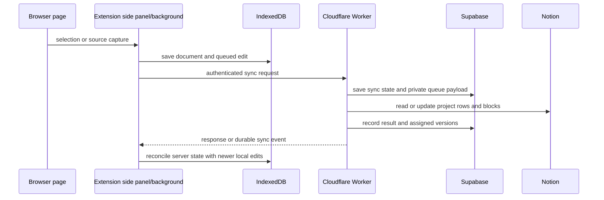

# Codebase map and simplification plan

Snapshot: 2026-10-29, branch `polish` at `a7ba63b`.

## System map

Jottathing is a Chrome Manifest V3 extension, a Cloudflare sync Worker, a Supabase-backed sync store, and a small Vite marketing app. The extension is the user interface and local editing surface; Notion remains the remote project and page store.

| System | Main files | Responsibility |
| --- | --- | --- |
| Extension startup | `wxt.config.ts`, `entrypoints/background.ts`, `entrypoints/content.ts`, `entrypoints/sidepanel/` | WXT builds the background worker, page content script, side panel, and sandboxed code runner. The content script captures page selections and restores highlights. The background script routes extension messages, opens source links, and hands captures to the active editor or local store. |
| Side panel | `entrypoints/sidepanel/App.vue`, `src/stores/jottathing.ts`, `entrypoints/sidepanel/composables/` | Vue and Pinia coordinate workspaces, projects, pages, settings, and sync state. Components render the panels; composables own editor, lifecycle, settings, and selection actions. Tiptap edits document blocks. |
| Capture and source metadata | `src/lib/capturePayload.ts`, `src/extensions/sourceRegistry.ts`, `src/lib/projectStateSources.ts`, `src/services/notionClient.ts` | Validates captured page data, inserts source links and headings, and tracks source metadata in project state so deleting or moving notes does not lose provenance. |
| Local persistence | `src/services/idbStore.ts`, `src/services/notionClient.ts` | IndexedDB stores projects, pages, workspace settings, and local queues. Writes are serialized through an epoch fence so a connection wipe cannot race another extension context. `notionClient.readStorage` currently also normalizes workspace/account ownership and fills local defaults. |
| Local sync queues | `src/services/syncQueue.ts`, `src/services/notionClient.ts` | Queues page block operations and project metadata/source events, compacts superseded edits, assigns local versions, and retries delivery after offline or server failures. |
| Worker API | `apps/worker/src/worker.ts`, `apps/worker/src/routes/` | Hono composes authentication, Notion page lookup, sync mutations and queries, webhooks, and media endpoints. The Worker owns Notion credentials and authorizes requests through Supabase-backed sessions and installations. |
| Notion sync domain | `apps/worker/src/projectDatabase*.ts`, `apps/worker/src/managedBlock*.ts`, `apps/worker/src/blockConversion/`, `apps/worker/src/pageSync.ts` | Discovers the managed Notion project database; maps project rows; converts Tiptap documents to and from Notion blocks; reconciles block identity, ordering, edits, and conflicts. |
| Durable delivery | `apps/worker/src/queues/syncQueueConsumer.ts`, `apps/worker/src/services/workerQueueOperations.ts`, `apps/worker/src/syncEvents.ts` | Stores private, versioned sync payloads in Supabase and sends Cloudflare Queue messages with opaque UUID references. Consumers validate the reference and payload, apply Notion mutations, record status, retry transient failures, and publish completion events through a Durable Object. |
| Authentication and deletion | `apps/worker/src/routes/authRoutes.ts`, `apps/worker/src/auth.ts`, `apps/worker/src/notionAuth.ts` | Runs Notion OAuth, creates and checks the app session, serializes OAuth with logout/deletion, and clears local credentials while preserving local documents and queued work. |
| Media | `apps/worker/src/routes/mediaRoutes.ts`, `src/extensions/media*.ts`, `entrypoints/sidepanel/composables/useEditorMedia.ts` | Validates and uploads media through the Worker, refreshes Notion-hosted URLs, and keeps editor media identity stable during sync. |
| Marketing site | `apps/marketing/src/` | Vite app with patch notes and an interactive extension demo. It is independent of extension persistence and sync. |
| Data and tests | `apps/worker/schema.supabase.sql`, `apps/worker/migrations/`, `test/` | The schema and migration history define Supabase persistence and privileged RPCs. Vitest covers capture, storage, sync queues, Notion conversion, auth lifecycle, and Worker behavior. |

### Worker routes

- `authRoutes.ts`: legal pages, OAuth start/callback, session status, logout, connection deletion, and diagnostic logs.
- `notionRoutes.ts`: Notion parent-page search/create and YouTube embed presentation.
- `syncMutationRoutes.ts`: page/block pushes, retries, page resync, project metadata, and project source updates.
- `syncQueryRoutes.ts`: sync status/events, validation, reload, pull, and stale-state cleanup.
- `webhookRoutes.ts`: protected webhook setup, verification-token operations, and Notion change notifications.
- `mediaRoutes.ts`: validated upload and signed-URL refresh.
- `worker.ts`: registers those routes, initializes the runtime, and dispatches normal and dead-letter queue batches.

### Data flow

The event queue carries opaque references; the page/block payload is held in an installation-owned Supabase table. This is why payload cleanup, account ownership, and deletion tests are part of the core sync contract.

## Simplification plan

Keep each slice independently reviewable: one behavior change, focused tests, then a commit. Preserve current page content, source provenance, offline edits, conflict review, account isolation, and deletion safety.

1. **Notion project schema compatibility — completed.** The Worker now reads only `Jottathing ID` and `Managed by Jottathing`; it no longer recognizes `Inkwell ID` / `Jot ID`, copies old property values, or scans rows for those names. It still creates missing current properties and handles a current property whose Notion type changes. The connected database has the current schema. `test/projectDatabase.test.ts` (8 tests) and Worker typecheck pass.
2. **Remove obsolete sync-queue adapters — completed.** The consumer now accepts only UUID references to versioned payloads in Supabase. It no longer interprets full inline queue messages, single-operation `op` payloads, or server version `0`. At review time, the connected Cloudflare queues had no backlog and the Supabase payload table was empty. The consumer privacy, payload security, and queue operation tests (12 tests) and Worker typecheck pass.
3. **Break up high-risk orchestration without changing behavior.** Fallow identified `syncQueueConsumer.processSyncQueue`, `notionClient.readStorage`, `notionClient.resyncPendingChanges`, and `notionClient.movePageToProject` as complexity hotspots. The queue consumer now delegates reference loading to `readQueuedSyncJob`; `processQueuedSyncJob` uses separate helpers for version repair, Notion mutation, completion, and failure policy. Its batch handler remains sequential, and tests cover orphaned references, stale pages, final and non-final block batches, permanent failures, and content-free payload cleanup. Next, review the storage and page orchestration functions against their owning tests.
4. **Prune verified dead code.** Completed the first confirmed slice: removed the unreferenced conflict-block predicate and made the YouTube parser helpers private to the module that uses them. Fallow also marks framework-loaded files as unused, so verify each remaining candidate against WXT entrypoints, package exports, route registration, and direct references before removal; test the owning feature after each deletion.
5. **Keep database history and local data safe.** The project has historical Supabase migrations and IndexedDB/write-fence logic. Do not delete database migrations needed to upgrade the deployed database. Remove only runtime adapters for formats confirmed absent from the current live data and retain state needed for the current user's local documents.
6. **Document the resulting boundaries.** Update this map when a removed system or extracted module changes ownership. Keep detailed code comments on invariants at the point where data is reconciled or deleted.

## Verification baseline

Before simplification, on this checkout:

- `corepack pnpm typecheck` passed.
- `corepack pnpm build` passed; Vite reported the existing large side-panel chunk warning.
- `corepack pnpm exec vitest run test/projectDatabase.test.ts` passed (9 tests).
- `corepack pnpm test` failed: 61 of 384 tests failed across 6 files, while 323 passed. Failures include stale-looking workspace expectations, queue test doubles, and managed-block conflict expectations. Treat this as pre-existing until reproduced against a focused behavior and fixed; do not use a green typecheck as a substitute for the suite.
- Before the queue refactor, Fallow reported `processSyncQueue` at cyclomatic 83 / cognitive 168, `readStorage` at 75 / 52, and 258 functions above its configured complexity thresholds. Its dead-code scan reports candidates that require manual confirmation.

After the queue consumer refactor, the focused queue suites pass (15 tests), root typecheck and the extension production build pass, and the full suite reports 58 failures / 330 passes across 388 tests with one unhandled rejection. The remaining failing files are `connectionLifecycle.test.ts`, `jottathingStore.optimistic.test.ts`, `managedBlocks.test.ts`, and `mediaUploadValidation.test.ts`; the queue consumer and payload-security tests pass. The full suite remains red.

Fallow's post-refactor scan reports 55,727 LOC, a 66/C health score, and 259 functions above its complexity thresholds. The next largest hotspots are `notionClient.movePageToProject` (76 cyclomatic / 76 cognitive), `notionClient.readStorage` (75 / 52), and `notionClient.resyncPendingChanges` (68 / 67).
